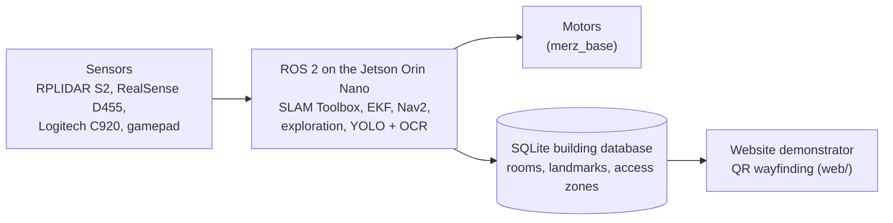

# Merz Mapper

**An autonomous rover that maps a floor of Merz Court, labels its rooms and landmarks, and records which rooms can be
reached from each entrance.** EEE3094 individual project, Newcastle University. The robot is the main contribution; the
website is only a demonstrator of the robot's data.


-22314E)

[](https://github.com/Moeaal/merz-mapper/actions/workflows/pages.yml)

Student: Mohammed Abdulaal | Supervisor: Dr Nick Wright

## Status
**Nothing is TESTED on hardware yet**: the parts have been ordered and the rover has not arrived. Details:
[`docs/MERZ_MAPPER_STATE.md`](docs/MERZ_MAPPER_STATE.md).

| Part | Status | Evidence so far |
| --- | --- | --- |
| ROS 2 packages (`ros2_ws/src`) | IMPLEMENTED | Unit tests; a cloud ROS 2 Humble `colcon build` + `colcon test` (software only) |
| Gazebo simulation (`merz_sim`) | IMPLEMENTED | Unit tests only; never launched |
| Sign-reading prototype (`perception/`) | PROPOSED | Unit tests on synthetic signs only |
| Evaluation scripts (`tools/eval`) | IMPLEMENTED | Synthetic data only |
| Website demonstrator (`web/`) | IMPLEMENTED | pytest + headless browser, synthetic run only |
| ROS 2 distro / JetPack, encoders, independent stop | PROPOSED | [`decisions.md`](docs/decisions.md) #6, #10, #19 |
| Experiments O1-O8 | PLANNED | [`experiments.md`](docs/planning/experiments.md); none run |

## Architecture


## Start here
- [`docs/MERZ_MAPPER_STATE.md`](docs/MERZ_MAPPER_STATE.md): current phase, next tasks, blockers (read first)
- [`docs/INDEX.md`](docs/INDEX.md): every document, by category
- [`docs/runbooks/o1-checklist.md`](docs/runbooks/o1-checklist.md): what to do when the parts arrive (G1, 18 Dec 2026)
- [`ros2_ws/README.md`](ros2_ws/README.md): the robot code

## Folders
| Folder | What is in it |
| --- | --- |
| [`ros2_ws/`](ros2_ws/) | ROS 2 workspace: the robot (8 packages, including the `merz_sim` simulation) |
| [`perception/`](perception/) | PROPOSED door-sign reading and YOLO training prototype (O3) |
| [`tools/`](tools/) | Evaluation scripts (O2-O8), rosbag frame extraction, website import/export, synthetic run |
| [`web/`](web/) | Demonstrator website: FastAPI, frontend source, built site, sample data |
| [`docs/`](docs/) | Project memory, plans, runbooks, research, logbook and meeting minutes |
| [`report/`](report/) | Poster (D2) and report (D4) drafts |
| [`data/`](data/) | Rosbags, maps and photos: local only, never committed |
| [`.claude/`](.claude/), [`.github/`](.github/) | Shared Claude Code settings; the GitHub Pages deploy workflow |

## Quick start (laptop, no ROS needed)
```bash
python -m venv .venv && . .venv/bin/activate      # Windows: .venv\Scripts\activate
pip install -r requirements-dev.txt
python -m pytest                                  # unit tests; ROS-only tests skip themselves
python -m uvicorn app.main:app --app-dir web      # website on http://localhost:8000
```
On the Jetson: [`docs/runbooks/jetson-bringup.md`](docs/runbooks/jetson-bringup.md), then
[`docs/runbooks/build-guide.md`](docs/runbooks/build-guide.md).
