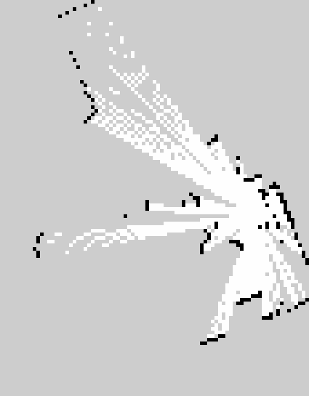

# Logbook - 2026-11-19

> DRAFT written by Claude from the session record. Student to check, add results, hours and reflection, then remove
> this line.

**Hours:** 
**Objective(s):** O1 (motor control)

## Planned today
- Measure the motors' starting duty and real wheel speed; fix low-speed humming; then gamepad teleop.

## Done
- Clean start: no `base_node` running (the bench script now refuses to start if one is, PR #25).
- Bench measurements with the rover lifted (no load, no floor friction).
- Re-checked the wheel map; corrected it in `merz_base` (decisions #36).
- `merz_base`: minimum-duty model so small commands turn the wheels (decisions #36).
- **`base_node` with `backend:=pca9685` on the bench (wheels lifted): forward (`linear.x 0.3`) and turn on the spot
  (`angular.z 0.8`) both correct; wheels stopped by themselves after Ctrl+C (command timeout).** First time ROS drives
  the motors.
- PS5 DualSense connected by USB-C; `/joy` indexes measured; `teleop.yaml` set to match (PR #27).
- **Bench teleop** (`base.launch.py backend:=pca9685` + `teleop.launch.py`, wheels lifted): stick without L1 ->
  nothing moves; L1 + left stick up -> forward; L1 + right stick left -> turns left; releasing L1 -> wheels stop.
  All correct.
- DualSense paired over **Bluetooth** with `bluetoothctl` (pair, trust, connect); `/dev/input/js0` without cable.
- **Gamepad link-loss test** (safety review R2, High): driving with L1 and the stick held, switched the pad off ->
  wheels stopped by themselves. Passed (lifted).

- Floor drive postponed: the bench set-up (mains extension lead, HATs on a breadboard, bench supply) cannot leave the
  bench. The rover must carry its own power first (battery + buck converter, wiring off the breadboard, mounting).
- `mapping.launch.py` gained `d455:=false` (PR #29) so a scan-only map can be made before the D455 arrives.
- **First map**, rover moved by hand at the bench: `mapping.launch.py d455:=false base:=false` (C1 LIDAR, rf2o scan
  odometry, EKF without IMU, SLAM Toolbox), recorded with `record_bag.launch.py name:=first_hand_map`, saved with
  `map_saver_cli` as `~/merz_data/maps/first_hand_map.{pgm,yaml}`.

## Results / measurements (wheels lifted - floor values will differ)
- Starting duty (`motor_bench_test.py --speed`): 10% -> 2 of 4 wheels turn (0x40 B, 0x41 A); 15% -> all 4 turn.
- Speed: 13 wheel turns in 10 s at 30% duty (0x40 A and 0x40 B); wheel diameter 8 cm -> 1.3 x pi x 0.08 =
  **0.33 m/s at 30%**. With a 15% start: full-speed estimate 0.33 x (1 - 0.15) / (0.30 - 0.15) = **1.85 m/s**.
- Wheel map (two runs, confirmed by me): **0x40 A = rear-left, 0x40 B = front-left, 0x41 A = front-right,
  0x41 B = rear-right.** The 16 Nov reading (0x40 = front axle) was wrong.

- DualSense `/joy` indexes: axes 0 = left stick L/R, 1 = left stick up/down, 2 = right stick L/R, 3 = L2 and
  4 = R2 (rest at 1.0), 5 = right stick up/down, 6-7 = d-pad; buttons 4 = L1. Teleop: L1 deadman, left stick
  up/down = forward/back, right stick left/right = turn.

- **First map** (`first_hand_map`): 85 x 109 cells at 0.05 m = 4.3 m x 5.5 m; 1076 free, 128 occupied, 8061 unknown
  cells. It is a "starburst": the LIDAR saw out mostly through gaps, with many returns 0.3-0.6 m away on one side
  (bench clutter and/or parts of the set-up blocking the scan). One far wall is a single clean line, so there is no
  sign of the scan matching slipping. The pipeline works; map quality needs the rover on the floor in open space.

  

- Bag `first_hand_map`: topics and size ___ (`ros2 bag info <one folder>`).

## Problems and how they were solved
- The 16 Nov wheel map was misread (late at night). With it, `merz_base` drove rear-left with front-right as "left",
  so turning on the spot made diagonal wheels fight. Corrected (decisions #36). Lesson: mark the front of the rover
  and check the map twice before writing it into code.

- New terminals did not find `merz_bringup`: the workspace was not sourced in `~/.bashrc` -> added
  `source ~/merz-mapper/ros2_ws/install/setup.bash` to `~/.bashrc`.
- `ros2 bag info ~/merz_data/bags/*_first_hand_map` failed with "unrecognized arguments": the pattern matched two bag
  folders, and `ros2 bag info` takes one.
- Lesson for mounting: nothing on the rover may sit in the LIDAR's scan plane, or every map gets the same blind
  sectors.

## Next
- Make the rover self-contained (battery + 12 V buck, wiring off the breadboard, mounting from the CAD), then the
  first floor drive, floor calibration and a first real map.
- Floor calibration: starting duty and speed under load (drive 2 m by laser meter, time it).

## Reflection
